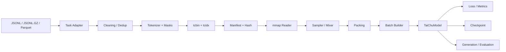

<div align="center">

# TaiChu · 太初

**一套从 Tokenizer 到预训练评估，全链路可读、可运行、可审计的 LLM 工程。**

不调用现成大模型接口，而是把 Byte-level BPE、Decoder-only Transformer、统一训练数据、
预训练、检查点和评估拆开讲清楚、写完整。

[](https://www.python.org/)
[](https://pytorch.org/)
[](#模型预设)
[](LICENSE)
[](https://github.com/Hsuant/TaiChu)

[项目定位](#项目定位) ·
[能力全景](#能力全景) ·
[系统架构](#系统架构) ·
[模型预设](#模型预设) ·
[快速开始](#快速开始) ·
[开发记录](#开发记录) ·
[已知边界](#已知边界)

</div>

---

## 项目定位

TaiChu 不是一层 API 包装，也不是只包含模型定义的最小示例。它试图回答一个更具体的问题：

> 如果要从零构建一个可训练的语言模型，代码、数据、指标和工程边界应该怎样组织？

项目以 **80M、150M、190M** 三档小模型为落点，用可检查的配置和测试串起完整链路：

```text
原始语料
  -> Byte-level BPE Tokenizer
  -> 统一 Schema 与离线数据准备
  -> tcbin/tcidx 二进制分片与 mmap 读取
  -> 采样、Packing、Batch Builder
  -> Decoder-only Transformer
  -> 训练、验证、检查点与独立评估
```

相比“把模型跑起来”，TaiChu 更关注另外四件事：

- **行为可解释**：labels 如何移位、padding 如何屏蔽、KV Cache 如何布局，都在代码中显式表达。
- **配置可复用**：Tokenizer、模型、数据和训练配置分层，模型规模可通过 YAML 切换。
- **数据可恢复**：数据集带有版本、Manifest、Content Hash 和可恢复的 DataState。
- **结果可验证**：通过手工公式对照、形状检查、边界测试和端到端预检发现静默错误。

> 仓库内置的是 **Tokenizer 产物与模型配置**，不包含已经训练好的语言模型权重。模型预设用于复现训练流程和开展小规模研究。

## 项目速览

| 维度 | 当前状态 |
|---|---:|
| Decoder-only 模型预设 | **3 档**：80M / 150M / 190M |
| 内置 Tokenizer 词表 | **32,768** |
| 固定特殊 Token | **9 个**，ID 为 `0-8` |
| 统一数据任务契约 | Pretraining、SFT、Preference、Reward、Trajectory、Multimodal |
| 测试执行项目 | **251 个测试项目** |
| Git 开发起点 | **2025-07-14** |
| 最新完整验证记录 | **249 passed, 2 skipped, 150 subtests passed** |

目标不是追求参数规模，而是建立一条 **可观察、可复现、可继续扩展** 的小模型基线。

## 能力全景

| 模块 | 已实现 | 工程边界 |
|---|---|---|
| **Tokenizer** | Byte-level BPE、NFC、数字拆分、流式语料读取、资源监控、特殊 Token 校验、Chat Template、HF 兼容导出 | 生产语料需要显式传入；默认配置中的外部路径不可直接复用 |
| **模型** | Pre-Norm Decoder、RoPE、MHA/GQA、SwiGLU、RMSNorm、权重绑定、可选 MoE、KV Cache | 小模型预设均为 Dense；MoE 作为独立架构能力保留 |
| **生成** | Greedy、Temperature、Top-K、Top-P、EOS、二维 Padding Mask、上下文边界检查 | 模型 `generate` 尚未实现 Beam Search；对话入口支持 Repetition Penalty |
| **数据** | 多格式流式读取、清洗、精确去重、任务 Adapter、Binary Shard、Manifest、mmap Reader | Packed 文档由 `segment_ids` 与块对角因果 Mask 隔离 |
| **采样与批处理** | Random、Distributed、Mixer、Shuffle Buffer、Stream/Sample-isolated Packing | 不同任务分别使用独立 Packing 与 Batch Builder |
| **训练** | 独立 `training/` 层、AdamW、WSD、AMP、梯度累积与裁剪、DDP、`torch.compile`、早停、数据位置与 RNG 恢复 | GPU、AMP、FlashAttention 和 NCCL 路径仍需实机验证 |
| **指标** | Token 加权 Loss、PPL、BPB、Accuracy、CE 分位数、BOS -> EOS 诊断 | 尚未集成 MMLU、C-Eval、HumanEval、GSM8K |
| **实验管理** | TensorBoard、SwanLab、结构化日志、阶段资源报告、独立评估入口 | 未配置 GitHub Actions CI |

## 系统架构



### 模型主干

```text
input_ids
  -> Token Embedding
  -> N x TaiChuBlock
       -> RMSNorm
       -> RoPE + Causal Self-Attention (MHA / GQA)
       -> Residual
       -> RMSNorm
       -> SwiGLU / Standard FFN / MoE
       -> Residual
  -> Final RMSNorm
  -> Output Head (tied with input embedding)
  -> logits / loss / KV Cache
```

关键实现位置：

- [`model/model.py`](model/model.py)：模型组装、Loss 与生成。
- [`model/attention.py`](model/attention.py)：掩码计划、因果注意力、GQA、KV Cache。
- [`model/transformer_block.py`](model/transformer_block.py)：Pre-Norm 解码器块。
- [`model/feedforward.py`](model/feedforward.py)：SwiGLU、标准 FFN 与 MoE FFN。
- [`model/positional_encoding.py`](model/positional_encoding.py)：实数形式 RoPE。

## 模型预设

所有预设都与内置 `32768` 词表对齐，上下文长度为 `2048`。

| 规格 | 实际参数量 | Hidden | Layers | Q / KV Heads | FFN | 目标 Token |
|---|---:|---:|---:|---:|---:|---:|
| **80M** | 80,757,248 | 512 | 16 | 8 / 2 | 2,176 | 4.0B |
| **150M** | 149,057,280 | 768 | 18 | 12 / 4 | 2,304 | 5.2B |
| **190M** | 191,394,816 | 1,024 | 14 | 16 / 4 | 2,816 | 7.0B |

模型与训练配置：

| 规格 | Model YAML | Training YAML | 单步 Padded Token |
|---|---|---|---:|
| 80M | [`configs/TaiChu_80M.yaml`](configs/TaiChu_80M.yaml) | [`configs/train_pretrain_80m.yaml`](configs/train_pretrain_80m.yaml) | 524,288 |
| 150M | [`configs/TaiChu_150M.yaml`](configs/TaiChu_150M.yaml) | [`configs/train_pretrain_150m.yaml`](configs/train_pretrain_150m.yaml) | 524,288 |
| 190M | [`configs/TaiChu_190M.yaml`](configs/TaiChu_190M.yaml) | [`configs/train_pretrain_190m.yaml`](configs/train_pretrain_190m.yaml) | 524,288 |

三个训练预设都把全局 Batch 设计为约 `0.5M Padded Token / Step`。多卡训练时，
应按 world size 调整梯度累积，保持全局 Token/Step 不变。

## 快速开始

> 以下命令使用 PowerShell。Bash 用户将行尾反引号 `` ` `` 替换为反斜杠 `\` 即可。

### 1. 环境安装

推荐 Python 3.10+。最新审计环境为 Python 3.13、PyTorch 2.10、CPU only。

```powershell
git clone https://github.com/Hsuant/TaiChu.git
cd TaiChu

python -m venv .venv
.\.venv\Scripts\Activate.ps1
python -m pip install --upgrade pip
python -m pip install -r requirements.txt
```

PyTorch 的 CUDA wheel 与平台相关。如需指定 CUDA 版本，建议先按
[PyTorch 官方安装方式](https://pytorch.org/get-started/locally/) 安装 PyTorch，再安装剩余依赖。

### 2. 验证内置 Tokenizer

```powershell
python -m trainer.validate_tokenizer `
  --config configs/TaiChu_Tokenizer_config.yaml `
  --tokenizer_dir taichu_tokenizer `
  --vocab_size 32768
```

该命令会检查词表大小、9 个特殊 Token 的 ID 与文件协议、随机 Unicode 往返、
单条与批量编码一致性，以及 Hugging Face 兼容加载。

### 3. 检查数据格式

生产预训练建议使用：

```text
data/raw/train/        # 训练原始文件
data/raw/validation/   # 与训练集隔离的验证原始文件
```

然后运行：

```powershell
python -m dataset.offline.prepare `
  --config configs/prepare_pretrain_data.yaml
```

默认会生成 `data/unified/taichu_80m/{train,validation,diagnostic}/`，
与 80M 训练配置一致。
切换到 150M 或 190M 时，需要同步修改准备配置的 `dataset_id`、`output_dir`，
以及训练配置中的 `storage.train_path` 与 `storage.validation_path`。

### 4. 运行训练基础设施预检

正式训练前先验证配置、模型 Loss、数据 Packing、优化器单步、Checkpoint 和
共享评估器：

```powershell
python -m pytest -q
```

CPU 小模型端到端预检：

```powershell
python tests/test_train/run.py
```

### 5. 启动预训练

单进程或单卡：

```powershell
python -m trainer.train_pretrain `
  --model_config configs/TaiChu_80M.yaml `
  --pretrain_config configs/train_pretrain_80m.yaml
```

`torchrun` 多卡启动：

```powershell
torchrun --standalone --nproc_per_node=4 `
  -m trainer.train_pretrain `
  --model_config configs/TaiChu_80M.yaml `
  --pretrain_config configs/train_pretrain_80m.yaml
```

从中断检查点恢复：

```powershell
python -m trainer.train_pretrain `
  --model_config configs/TaiChu_80M.yaml `
  --pretrain_config configs/train_pretrain_80m.yaml `
  --resume experiments/small_models/taichu_80m_pretrain_v1/checkpoints/checkpoint-1000.pt
```

恢复时会沿用检查点所在的实验目录。若检查点中保存了 SwanLab run id，
训练器会自动使用官方 `swanlab.init(..., id=..., resume="must")` 继续原实验；
也可以通过配置或命令行显式覆盖：

```yaml
swanlab:
  use_swanlab: true
  swanlab_project: "TaiChu-Small"
  swanlab_workspace: "ByteWyrm"
  swanlab_id: "gmdnabup"
  swanlab_resume: "must"
  swanlab_init_kwargs:
    tags: ["resume"]
```

```powershell
python -m trainer.train_pretrain `
  --model_config configs/TaiChu_80M.yaml `
  --pretrain_config configs/train_pretrain_80m.yaml `
  --resume experiments/small_models/taichu_80m_pretrain_v1/checkpoints/checkpoint-1000.pt `
  --swanlab_workspace ByteWyrm `
  --swanlab_id gmdnabup `
  --swanlab_resume must
```

常用命令行覆盖项：

```powershell
python -m trainer.train_pretrain --help
```

`torch.compile` 默认使用 `auto` 模式：单卡 CUDA 动态形状走
`max-autotune-no-cudagraphs`，多卡 DDP 与 CPU 走 `default`。多卡时避免
rank 本地自动调优长时间阻塞 NCCL collective。可用以下参数覆盖：

```powershell
--compile_model --compile_mode auto --compile_dynamic
--no-compile_model
```

Windows CPU 编译需要 MSVC `cl`；缺少编译器时训练器会在启动阶段直接回退
eager，避免在首个训练步反复尝试编译。

多卡训练默认将进程组 `timeout` 设为 30 分钟，可通过预训练配置的
`training.distributed_timeout_minutes` 调整，避免首次编译或动态形状
重编译先触发 10 分钟 NCCL watchdog。启用 `torch.compile` 时，训练器会在
包装 DDP 前用正式训练形状执行一次前向和反向，并同步所有 rank，确保编译
不会与首个梯度 `ALLREDUCE` 交错。不要同时设置 `NCCL_P2P_DISABLE=1` 与
`NCCL_SHM_DISABLE=1`，除非平台明确要求；后者会关闭同机共享内存通信路径，
显著放大 rank 间速度差和超时风险。

每次运行会创建独立实验目录，并生成：

```text
experiments/small_models/<experiment_name>/
├── best_models/
│   └── best_model.pt             # 验证最优的最小推理产物
├── checkpoints/
│   ├── checkpoint-{step}.pt      # 完整训练状态，滚动保留
│   ├── checkpoint-final.pt       # 正常结束时的完整训练状态
│   └── checkpoint-emergency.pt   # 可选异常恢复状态
├── final_models/
│   └── final_model.pt            # 最终模型的最小推理产物
└── logs/
```

### 6. 独立评估

```powershell
python -m eval.eval_pretrain_model `
  --pretrain_config configs/train_pretrain_80m.yaml `
  --exp_dir experiments/small_models/taichu_80m_pretrain_v1 `
  --artifact best `
  --generate `
  --num_generate_tokens 32
```

`--artifact best` 加载 `best_models/best_model.pt`，`--artifact final`
加载 `final_models/final_model.pt`。也可通过 `--checkpoint` 指定其他最小模型产物。
评估结果分别写入 `evaluation/best/` 或 `evaluation/final/`。

旧实验中的完整 `best_model.pt` / `final_model.pt` 可一次性迁移：

```powershell
python scripts/migrate_model_artifacts.py `
  --experiment experiments/small_models/taichu_80m_pretrain_v1
```

旧最佳完整文件会保留在 `legacy/`，旧最终完整状态会移动到
`checkpoints/checkpoint-final.pt`。

### 7. 运行测试

```powershell
python -m pytest -q
```

测试覆盖模型形状与数值对照、因果掩码、GQA/MHA、KV Cache、生成一致性、
SwiGLU、RMSNorm、MoE、Checkpoint、数据 Schema、Binary Storage、离线准备、
Runtime 数据流和训练完整性。

## 最小推理示例

```python
import torch
from tokenizers import Tokenizer

from model import TaiChuModel
from model.config import load_model_config
from training.model_artifacts import load_model_artifact

tokenizer = Tokenizer.from_file("taichu_tokenizer/tokenizer.json")
config = load_model_config("configs/TaiChu_80M.yaml")
model = TaiChuModel(config).eval()

artifact = load_model_artifact(
    "experiments/small_models/taichu_80m_pretrain_v1/final_models/final_model.pt",
    model,
)
print(
    f"step={artifact['global_step']} "
    f"metrics={artifact['metrics']}"
)

prompt_ids = tokenizer.encode("太初是什么？", add_special_tokens=False).ids
input_ids = torch.tensor([prompt_ids], dtype=torch.long)
output_ids = model.generate(
    input_ids,
    max_new_tokens=32,
    temperature=0.8,
    top_k=50,
    top_p=0.9,
    eos_token_id=tokenizer.token_to_id("<|taichu_end|>"),
)

print(tokenizer.decode(output_ids[0].tolist(), skip_special_tokens=True))
```

## 对话入口

实验 80M 检查点可通过独立的终端对话入口加载：

```powershell
& 'D:\Environments\Anaconda\envs\AI\python.exe' -m chat `
  --config configs/chat_80m.yaml
```

入口按 `config -> runtime -> session -> engine -> cli` 分层，支持 Chat Template、
多轮上下文裁剪、KV Cache 流式输出、Top-K/Top-P 采样、重复惩罚与失败回滚。
单次生成可使用 `--prompt`，详细说明见
[`docs/CHAT_ENTRY.md`](docs/CHAT_ENTRY.md)。

默认检查点为
`experiments/80m/taichu_80m_pretrain_v1/best_models/best_model.pt`。
该实验权重是预训练基座，不是经过 SFT 或偏好对齐的指令模型。

## 预训练续写测试

原始文本续写探针不套用 Chat Template，直接测试基座的 next-token 分布：

```powershell
& 'D:\Environments\Anaconda\envs\AI\python.exe' `
  -m eval.pretrain_probe `
  --config configs/pretrain_probe_80m.yaml `
  --prompt "清晨，阳光透过窗户洒进房间，" `
  --max-new-tokens 64
```

支持交互式续写、多条 `--prompt`、文本/JSONL 提示文件和 JSONL 批量结果。
该程序只做生成观察；验证集 Loss、PPL、BPB 等定量评估仍由
`eval/evaluate_pretrain_model.py` 负责。详细用法见
[`docs/PRETRAIN_PROBE.md`](docs/PRETRAIN_PROBE.md)。

## Tokenizer 协议

内置 Tokenizer 使用 Byte-level BPE、NFC 归一化、数字拆分和
`add_special_tokens=False` 的显式特殊 Token 控制。固定 ID 如下：

| ID | Token | 用途 |
|---:|---|---|
| 0 | `<\|pad\|>` | Padding |
| 1 | `<unk>` | Unknown |
| 2 | `<\|endoftext\|>` | 文档结束 |
| 3 | `<\|taichu_start\|>` | BOS，消息开始 |
| 4 | `<\|taichu_end\|>` | EOS，消息结束 |
| 5 | `<\|think\|>` | 思考区段开始 |
| 6 | `<\|/think\|>` | 思考区段结束 |
| 7 | `<\|ghissue\|>` | 项目保留 Token |
| 8 | `<\|final\|>` | 项目保留 Token |

Chat Template 支持 system、user、assistant 多轮消息、`reasoning_content`、
空消息过滤和 `add_generation_prompt`。

重新训练 Tokenizer：

```powershell
python -m trainer.train_tokenizer `
  --config configs/TaiChu_Tokenizer_config.yaml `
  --data_files D:\data\corpus.jsonl `
  --report experiments/tokenizer_memory.json
```

默认配置包含作者本机的外部语料路径，实际使用时必须通过 `--data_files` 覆盖。
资源受限环境可增加 `--low-memory`。

## 统一数据基础设施

项目只保留一条训练数据主路径：

```text
Raw records
  -> task preprocessing adapter
  -> cleaning / exact dedup
  -> tokenization / masks / metadata
  -> tcbin + tcidx shards
  -> manifest + content hash
  -> indexed mmap reader
  -> sampler / mixer
  -> packing
  -> batch builder
  -> model input adapter
```

`tcbin` 保存 Metadata 与按字段编码的一维数组，`tcidx` 保存定长 Record Offset。
Reader 通过只读 `mmap` 随机访问样本，训练热路径不重新读取 JSONL，也不重复 Tokenize。

| 任务 | 数据契约 | Packing | 当前工程状态 |
|---|---|---|---|
| Pretraining / CPT | `PretrainingSample` | Stream | 已接入预训练 |
| SFT / Instruction Tuning | `SFTSequenceSample` | Sample-isolated | 数据契约与 Batch 已实现，训练器未接入 |
| Preference / DPO / IPO / KTO | `PreferenceSample` | Disabled | 数据契约已实现，优化目标未实现 |
| Reward Model | `RewardSample` | Disabled | 数据契约已实现，Reward Head 未实现 |
| RLHF / PPO / GRPO | `TrajectorySample` | Disabled | 离线/在线数据接口已预留，算法未实现 |
| Multimodal | `MultimodalSample` | 模型决定 | Schema 已预留，训练未接入 |

完整 Schema、模块依赖、Packing 与扩展规则见
[`docs/UNIFIED_DATA_INFRASTRUCTURE.md`](docs/UNIFIED_DATA_INFRASTRUCTURE.md)。

## 损失与指标

因果语言模型损失只在模型内部执行一次 shift：

```text
shift_logits = logits[:, :-1, :]
shift_labels = labels[:, 1:]
loss = CrossEntropy(shift_logits, shift_labels, ignore_index=-100)
```

数据层保持 labels 与 input_ids 对齐，不做提前移位。Padding 位置的 mask 必须为 `0`，
对应 label 必须为 `-100`。

验证阶段输出：

| 指标 | 含义 |
|---|---|
| `val_loss` | 有效 Next-Token 的 Token 加权交叉熵 |
| `val_perplexity` | `exp(val_loss)`，仅适合同 Tokenizer 内比较 |
| `val_bpb` | 排除特殊 Token 后的 Bits per UTF-8 Byte |
| `val_accuracy` | Next-Token Top-1 Accuracy |
| `val_ce_p50/p90/p95` | 逐 Token CE 的精确线性分位数 |
| `val_ce_max_exact` | 逐 Token CE 的精确最大值，用于发现异常长尾 |
| `empty_prefix_eos_ce/ppl` | 可选 `[BOS, EOS]` 转移诊断，默认关闭 |

无效指标返回 `None/null`，不会写入 `Infinity` 或 `NaN`。
公式、分布式聚合与边界处理见 [`docs/METRICS_AUDIT.md`](docs/METRICS_AUDIT.md)。

## 项目目录

```text
TaiChu/
├── model/                    # Attention、RoPE、FFN、MoE、Transformer、生成
├── tokenizer/                # BPE 训练、读取、归一化、验证与导出
├── dataset/
│   ├── schema/               # 多任务类型化样本契约
│   ├── storage/              # tcbin/tcidx、Manifest、mmap Reader
│   ├── offline/              # 流式读取、清洗、去重、Adapter、准备入口
│   ├── sampling/             # Random、Distributed、Mixer、Shuffle
│   ├── packing/              # Stream 与 Sample-isolated Packing
│   ├── batching/             # Batch Builder、Padding、Segment 对齐
│   ├── adapters/             # Model Input Adapter
│   └── runtime/              # DataLoader、在线 Buffer、Resume
├── trainer/                  # 预训练主体训练循环、组件装配与启动入口
├── training/                 # 配置、环境、优化器、Checkpoint、评估等可复用组件
├── eval/                     # Tokenizer 与预训练模型独立评估
├── utils/                    # 可选可视化工具
├── configs/                  # 模型、训练、数据与 Tokenizer YAML
├── data/
│   ├── samples/              # 仓库内样例数据
│   ├── eval/                 # 评估样例
│   └── raw|unified/          # 生产数据目录，默认不提交
├── tests/                    # 单元、集成与端到端测试
└── taichu_tokenizer/         # 内置 32K Tokenizer 产物
```

## 开发记录

TaiChu 的开发过程本身就是项目的一部分。以下时间线来自 Git 提交与仓库审计文档，
记录了项目从模型原型走向统一训练系统的过程。

| 时间 | 里程碑 | 主要变化 |
|---|---|---|
| **2025-07-14** | 项目起步 | 初始模型、KV Cache、预训练框架、日志和基础测试进入仓库 |
| **2025-07 至 2025-09** | 模型与训练原型 | 持续重构 Attention、位置编码、FFN、数据集与训练循环 |
| **2025-11 至 2025-12** | 训练框架成形 | 权重绑定、生成、验证集、最佳模型保存与配置体系完善 |
| **2026-05** | 工程重建 | 调整 GQA、WSD Scheduler、`torch.compile`、混合精度和实验目录管理 |
| **2026-06** | Tokenizer 专项 | 使用双语语料重训 Tokenizer，引入 NFC、数字拆分、HF 兼容与质量评估 |
| **2026-10-26** | 系统审计 | 对 Tokenizer、数据、损失、指标、训练、配置和文档做一致性审计 |
| **2026-11-02** | 统一基础设施 | 引入类型化 Schema、Binary mmap 数据、Runtime Resume、三档小模型配置与端到端预检 |

截至 **2026-11-02**，仓库累计约 **394 次提交**，经历了“原型验证 -> 重构 -> 审计 ->
统一数据基础设施”的完整演进。开发记录不只是功能增加，也包含多次删除旧加载器、
修正监督语义和收窄文档承诺。

## 验证基线

最新完整验证记录来自 **2026-11-11**：

```text
249 passed, 2 skipped, 150 subtests passed
```

验证重点包括：

- 特殊 Token ID、文件协议、Chat Template 和 Unicode 往返。
- Full Load 与 Parquet/Worker 分片的一致性。
- labels、attention mask、packing 和 Worker 所有权。
- Attention 手工参考、因果性、MHA/GQA、KV Cache。
- SwiGLU、RMSNorm、MoE、主损失与辅助损失。
- PPL、BPB、Accuracy、CE 分位数和严格 JSON 输出。
- Checkpoint 保存/恢复、独立评估和生成。

当前测试覆盖新训练基础设施、RNG 状态恢复、严格配置解析、训练/验证/Checkpoint
集成和验证集文档级抽样。在 GPU 或多卡环境使用前，仍应在目标机器重新执行完整测试。

历史审计的 CPU 模拟训练完成了 79 个优化步，并跑通训练、验证、Checkpoint、
日志和独立评估。其结果只证明链路有效，不代表小模型已经具备可用的语言能力。

完整证据和剩余风险见 [`docs/REFACTOR_REPORT.md`](docs/REFACTOR_REPORT.md)。

## 已知边界

| 边界 | 当前影响 | 后续方向 |
|---|---|---|
| CUDA、AMP、FlashAttention 未完成实机审计 | 不能宣称 GPU 训练路径已稳定 | 在 Ampere/Hopper GPU 上复跑测试与短训练 |
| 多卡 NCCL 未完成实机验证 | 不能宣称 DDP 稳定性 | 使用 2/4 卡 `torchrun` 做通信与恢复测试 |
| 无 Activation Checkpointing | 低显存训练 150M/190M 受限制 | 在 Transformer Block 增加可配置重计算 |
| Packing 文档隔离 Attention | `segment_ids` 已构造块对角因果 Mask，跨文档 Key 不可见 | 使用模型侧 Attention 等价测试防止回归 |
| 无下游 Benchmark | 无法评价知识、推理、代码与安全能力 | 接入 MMLU、C-Eval、HumanEval、GSM8K 等 |
| 分布式精确分位数集中到 rank 0 | rank 0 CPU 内存随验证 token 数增长 | 超大验证集使用独立离线分位数评估 |
| MFU 使用近似 FLOPs 公式 | 只能作为硬件效率参考 | 接入更精确的算子级 FLOP 统计 |
| SFT/Preference/RLHF 仅完成数据契约 | 不能把 Schema 误认为算法已支持 | 分别实现训练器、Loss、Reference Model 与 Rollout |
| Tokenizer 配置包含外部语料路径 | 直接运行生产训练会找不到数据 | 使用 `--data_files` 或维护本地配置副本 |

## 文档导航

| 文档 | 内容 |
|---|---|
| [`docs/REFACTOR_REPORT.md`](docs/REFACTOR_REPORT.md) | 本轮训练框架重构、行为变化、验证结果与遗留风险 |
| [`docs/TRAINING_ARCHITECTURE.md`](docs/TRAINING_ARCHITECTURE.md) | 重构后的训练分层、核心接口、状态所有权与扩展方式 |
| [`docs/MODEL_ARTIFACTS.md`](docs/MODEL_ARTIFACTS.md) | Best、Final 与 Resumable Checkpoint 的目录、格式和保存规则 |
| [`docs/AUDIT_REPORT.md`](docs/AUDIT_REPORT.md) | 系统审计、问题修复、测试证据与剩余风险 |
| [`docs/UNIFIED_DATA_INFRASTRUCTURE.md`](docs/UNIFIED_DATA_INFRASTRUCTURE.md) | 多任务数据生命周期、Schema、Storage、Runtime 与扩展规则 |
| [`docs/TOKENIZER_OPTIMIZATION_REPORT.md`](docs/TOKENIZER_OPTIMIZATION_REPORT.md) | Tokenizer 设计、资源测量、特殊 Token 与 Chat Template |
| [`docs/METRICS_AUDIT.md`](docs/METRICS_AUDIT.md) | Loss、PPL、BPB、MoE 辅助损失与指标边界 |
| [`dataset/ARCHITECTURE.md`](dataset/ARCHITECTURE.md) | Dataset 包分层与依赖方向 |
| [`dataset/README.md`](dataset/README.md) | Dataset 公共 API 与任务入口 |
| [`dataset/offline/README.md`](dataset/offline/README.md) | 原始记录到 Binary Dataset 的离线准备流程 |
| [`data/README.md`](data/README.md) | 样例数据、生产数据目录与忽略规则 |

## 许可证

仓库根目录使用 [CC BY-NC 4.0](https://creativecommons.org/licenses/by-nc/4.0/)：
允许署名非商业使用、修改与再分发，禁止未经授权的商业用途。商业授权请联系
[`hsuantx@163.com`](mailto:hsuantx@163.com)。

`taichu_tokenizer/tokenizer_config.json` 的 `model_info` 中仍有历史上的
“Apache 2.0”元数据；发布或再分发时，应统一以仓库根目录的 `LICENSE` 为准并修正该元数据。

## 参考

- [Attention Is All You Need](https://arxiv.org/abs/1706.03762)
- [RoFormer: Enhanced Transformer with Rotary Position Embedding](https://arxiv.org/abs/2104.09864)
- [GQA: Training Generalized Multi-Query Transformer Models from Multi-Head Checkpoints](https://arxiv.org/abs/2305.13245)
- [Root Mean Square Layer Normalization](https://arxiv.org/abs/1910.07467)
- [GLU Variants Improve Transformer](https://arxiv.org/abs/2002.05202)
- [Switch Transformers](https://arxiv.org/abs/2101.03961)
- [ST-MoE: Designing Stable and Transferable Sparse Expert Models](https://arxiv.org/abs/2202.08906)

<div align="center">

**从一行 Token 开始，把语言模型的每一层真正跑通。**

</div>
