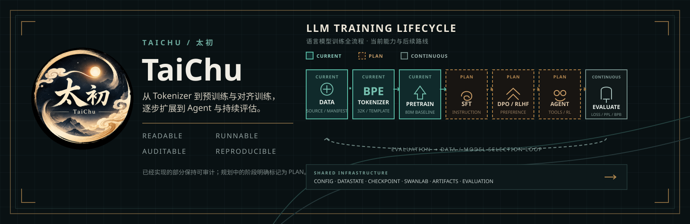
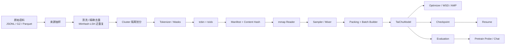
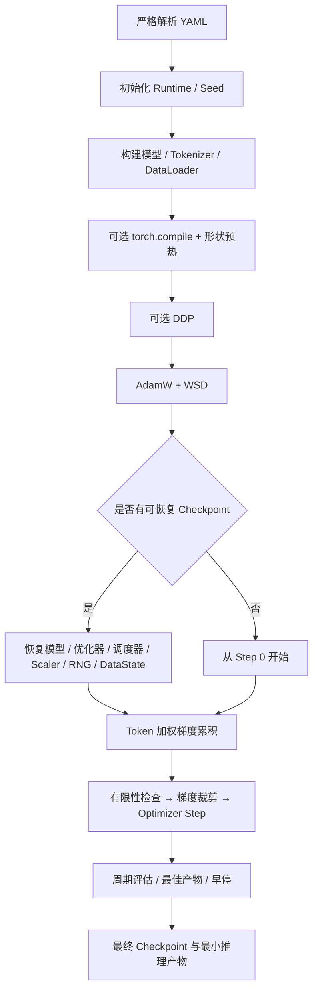

<div align="center">


# TaiChu · 太初

**从 Tokenizer 到预训练评估，构建一套可读、可运行、可审计的小语言模型工程。**

不封装现成大模型 API，而是把 Byte-level BPE、Decoder-only Transformer、统一数据、
预训练、检查点、评估和推理拆开实现，让每一段链路都能被检查、复现和继续扩展。

[](https://www.python.org/)
[](https://pytorch.org/)
[](#八训练实验)
[](#四模型与-tokenizer)
[](#十项目进度)
[](LICENSE)
[](https://github.com/Hsuant/TaiChu)

[项目介绍](#一项目介绍) ·
[核心特性](#二核心特性) ·
[系统架构](#三系统架构) ·
[模型](#四模型与-tokenizer) ·
[数据](#五数据体系) ·
[训练](#六训练框架) ·
[实验](#八训练实验) ·
[快速开始](#七环境安装与快速开始) ·
[文档导航](#十一文档导航)



> 当前公开成果是 **80M 预训练基座实验**。仓库尚未实现 SFT、DPO、RLHF 或 Agent
> 训练，现有相关 Schema 只代表数据契约，不代表算法能力。

</div>

---

## 一、项目介绍

TaiChu（太初）是一个面向研究、教学和工程验证的开源小语言模型项目。它关注的
不只是“能否完成一次训练”，而是以下问题能否被稳定回答：

| 问题 | TaiChu 的回答 |
|---|---|
| Token 从哪里来？ | 可训练、可验证、可导出到 Hugging Face 兼容格式的 Byte-level BPE Tokenizer |
| 数据怎样进入模型？ | 文档级清洗、去重、隔离划分、滑窗编码、二进制分片与 `mmap` 读取 |
| 训练是否可恢复？ | 模型、优化器、调度器、Scaler、RNG 与数据位置一起保存 |
| 指标是否可信？ | Token 加权 Loss、PPL、BPB、Accuracy、精确 CE 分位数统一实现 |
| 结果能否解释？ | 配置、Manifest、实验日志、独立评估与最小推理产物均可追踪 |

### 开发动机

大型模型的训练过程经常被框架封装成少数几行调用，初学者能看到结果，却很难观察
数据如何变成 Token、Loss 如何聚合、Packing 如何影响 Attention、Checkpoint 如何
恢复。TaiChu 选择从小模型切入，把关键状态和边界显式写进代码与文档。

项目采用 **80M / 150M / 190M** 三档 Dense Decoder-only 配置。规模的目标不是追求
榜单，而是建立一条适合单机研究、可逐步扩展到多卡验证的工程基线。

### 设计理念

- **先讲清楚，再跑起来**：数据格式、张量形状、Loss 对齐和恢复状态都要有明确契约。
- **真实边界优先于能力包装**：未实现的功能不写进“已支持”，待核实的数据不补造。
- **可复现胜过一次性结果**：固定种子、版本化数据、严格配置和实验记录共同工作。
- **模块化但不万能化**：共享数据、训练和评估基础设施，任务目标保持独立。

### 长期目标

TaiChu 希望最终形成一套覆盖预训练、SFT、偏好优化与 Agent 数据闭环的小模型研究
基础设施。当前阶段只完成其中第一条可验证主线：**预训练基座**。

## 二、核心特性

| 能力层 | 当前实现 | 工程价值 |
|---|---|---|
| **Tokenizer** | Byte-level BPE、NFC、数字拆分、9 个固定特殊 Token、Chat Template、HF 兼容导出 | 让训练、评估和推理使用同一套 Token 协议 |
| **模型结构** | Pre-Norm Decoder、RoPE、MHA/GQA、SwiGLU、RMSNorm、权重绑定、KV Cache、可选 MoE | 结构保持可读，同时覆盖现代 Decoder 的关键组件 |
| **统一数据** | Schema、流式读取、清洗、精确/近重复去重、Cluster 隔离、`tcbin/tcidx`、Manifest | 训练热路径不重复解析文本或 Tokenize |
| **Packing** | Stream Packing、`segment_ids`、块对角因果 Mask、组内 `position_ids` | 多条文档物理拼接后仍保持语义隔离 |
| **训练执行** | AdamW、WSD、AMP、梯度累积、梯度裁剪、DDP、`torch.compile`、早停 | 单进程可调试，多卡路径保留严格状态协调 |
| **实验追踪** | TensorBoard、SwanLab、结构化日志、资源摘要、独立评估 | 训练日志与评估产物可长期归档 |
| **推理入口** | 原始文本续写探针、终端 Chat、KV Cache 流式生成 | 区分预训练分布观察与对话协议验证 |
| **质量保障** | 架构、数值、数据、恢复、评估与端到端 CPU 预检 | 当前本地审计为 `249 passed, 2 skipped, 150 subtests passed` |

> 测试数量来自 2026-11-12 的当前维护工作区。仓库历史最后一次提交已删除
> `tests/`，而本工作区又将其加入忽略规则；若要在公开仓库复现测试基线，需先
> 决定测试目录的版本控制策略。详见 [项目状态](docs/project-status.md)。

## 三、系统架构

TaiChu 把“数据生产”“模型定义”“训练执行”和“推理评估”分开。配置只负责装配，
运行时组件通过类型化契约交接，避免一个训练脚本同时承担所有职责。



```text
model/       Decoder 结构、Attention、RoPE、FFN、生成
tokenizer/   BPE 训练、规范化、特殊 Token、Chat Template
dataset/     数据 Schema、离线准备、二进制存储、采样、Packing、Runtime
training/    配置、优化器、环境、Checkpoint、评估、日志、模型产物
trainer/     预训练装配与主体训练循环
eval/        基座定量评估与原始文本续写探针
chat/        终端对话入口、上下文管理与流式采样
configs/     模型、训练、数据与推理配置
docs/        架构、状态、实验与维护文档
```

核心设计原则是 **状态所有权单一**：数据位置归 `dataset.runtime`，模型参数归
`model`，训练步与最佳指标归 `CausalLMTrainer`，完整训练状态归
`CheckpointManager`，最小推理产物归 `BestModelStore`。详细分层见
[训练架构](docs/TRAINING_ARCHITECTURE.md)。

## 四、模型与 Tokenizer

### 4.1 模型预设

所有预设共享 `32,768` 词表、`2,048` 上下文和 Dense SwiGLU Decoder 结构。
参数量由当前架构测试直接构造模型并求和验证。

| 配置 | 参数量 | Hidden | Layers | Q / KV Heads | FFN | 上下文 |
|---|---:|---:|---:|---:|---:|---:|
| **TaiChu-80M** | 80,757,248 | 512 | 16 | 8 / 2 | 2,176 | 2,048 |
| **TaiChu-150M** | 149,057,280 | 768 | 18 | 12 / 4 | 2,304 | 2,048 |
| **TaiChu-190M** | 191,394,816 | 1,024 | 14 | 16 / 4 | 2,816 | 2,048 |

模型配置位于 [`configs/`](configs/)，训练配置位于同目录的
`train_pretrain_{80m,150m,190m}.yaml`。

### 4.2 技术实现

```text
input_ids
  → Token Embedding
  → N × TaiChuBlock
       → RMSNorm → RoPE + Causal Attention → Residual
       → RMSNorm → SwiGLU / Standard FFN / MoE → Residual
  → Final RMSNorm
  → Tied Output Head
  → logits / token-weighted loss / KV Cache
```

- **Pre-Norm + RMSNorm**：降低深层残差路径的优化难度。
- **RoPE**：在 Attention 的 Q/K 上注入旋转位置信息。
- **GQA**：KV Head 少于 Q Head，降低推理缓存占用。
- **SwiGLU**：门控前馈网络，Dense 预设统一使用。
- **权重绑定**：输入 Embedding 与输出 Head 共享参数。
- **KV Cache**：增量生成只输入最新 Token，同时保留历史 K/V。
- **可选 MoE**：代码保留专家路由、负载均衡损失与 router z-loss，三档公开预设均为 Dense。

模型参数量可写为：

```text
VH + N × (H² + 2HKd + H² + 3HI + 2H) + H
```

其中 `V` 为词表，`H` 为 Hidden，`N` 为层数，`K` 为 KV Heads，`d=H/Q Heads`，
`I` 为 FFN 中间维度。完整推导与边界见
[模型与 Tokenizer 文档](docs/MODEL_AND_TOKENIZER.md)。

### 4.3 Tokenizer 协议

内置 Tokenizer 使用 Byte-level BPE、NFC、数字拆分和显式特殊 Token 控制。
固定 ID 如下：

| ID | Token | 用途 |
|---:|---|---|
| 0 | `<\|pad\|>` | Padding |
| 1 | `<unk>` | Unknown |
| 2 | `<\|endoftext\|>` | 通用文本结束 |
| 3 | `<\|taichu_start\|>` | BOS / 消息开始 |
| 4 | `<\|taichu_end\|>` | EOS / 消息结束 |
| 5 | `<\|think\|>` | 思考区段开始 |
| 6 | `<\|/think\|>` | 思考区段结束 |
| 7 | `<\|ghissue\|>` | 项目保留 Token |
| 8 | `<\|final\|>` | 项目保留 Token |

Tokenizer 配置中的正式语料路径来自作者本地环境，不能直接复用。重训时应通过
命令行或本地配置覆盖语料路径。`tokenizer_config.json` 的历史 `model_info.license`
仍写作 Apache 2.0，但仓库总体发布协议以根目录 `LICENSE` 为准。

## 五、数据体系

TaiChu 只保留一条训练数据主路径：**原始记录 → 离线准备 → 版本化二进制数据
→ Runtime → Packing/Batch → 模型输入**。

### 5.1 当前数据来源

80M 预设定义 10 个语料来源，原始抽样预算为 18 GB，其中中文约 60%、
英文约 40%。这是 **仓库配置预算**，不等同于已经证明的第一阶段实际消耗量。

| 语言组 | 来源 |
|---|---|
| 中文 | FineWeb2、IndustryCorpus、CCI HQ、百科/Wiki |
| 英文 | FineWeb、FineWeb-Edu、PES2O、AutoMath ArXiv、AutoMath Code、百科/Wiki |

实际实验的样本数、唯一 Token 数、来源占比和去重率应以该次运行的
`dataset_manifest.json` 为准。当前公开 SwanLab 页面未展示这些字段，实验档案中
已标记为“待补充”。

### 5.2 离线处理

```text
原始 JSONL / JSONL.GZ / Parquet
  → 字段校验
  → NFC 清洗
  → 文档级精确去重
  → 13-gram MinHash + LSH 候选
  → 精确 Jaccard 复核
  → 重复 Cluster 稳定划分 train / validation / diagnostic
  → 全文档 Tokenization
  → 2,046 Token 窗口、128 重叠、1,918 步长
  → tcbin / tcidx + Manifest
```

窗口的 BOS/EOS 与 Loss 规则保证正文 Token 恰好被监督一次；重叠区只作为上下文，
使用 `-100` 屏蔽。Packing 后通过 `segment_ids` 构造块对角因果 Mask，避免不同文档
或不同滑窗互相 Attention。

### 5.3 存储与恢复

`tcbin` 保存 JSON Metadata 和按字段编码的一维数组，支持 `int16`、`uint16`、
`int32`、`int64`、`float32`；`tcidx` 保存定长 Record Offset。Reader 使用只读
`mmap`，让训练热路径不重新读取原始文本。

`DataState` 保存数据集 ID、版本、Epoch、Batch Index 和已消费样本数。恢复训练时
会校验 Dataset Identity，再从对应位置继续。

详细说明：

- [统一数据基础设施](docs/UNIFIED_DATA_INFRASTRUCTURE.md)
- [预训练数据管线](docs/PRETRAINING_DATA_PIPELINE.md)
- [数据目录说明](data/README.md)

## 六、训练框架

### 6.1 训练流程



关键训练策略：

| 项目 | 实现 |
|---|---|
| Loss | 模型内一次 shift；有效 Token 加权交叉熵 |
| Optimizer | AdamW；Bias 与 Norm 参数不做 Weight Decay |
| Scheduler | Warmup-Stable-Decay；支持 Cosine / Linear 衰减 |
| Precision | BF16 / FP16 AMP；CPU 验证走兼容路径 |
| Accumulation | 使用全局有效 Token 数归一化，而非简单平均 Micro-batch |
| Stability | 所有 Rank 同步检查有限 Loss/Gradient；连续异常跳过并记录 |
| Recovery | 原子写入；RNG、Scaler、Scheduler、数据位置与 SwanLab ID 一并保存 |

### 6.2 单进程参考预算

下表按 `world_size=1`、`max_seq_length=2048` 计算。多卡时若希望保持相同的
Token/Step，应同步缩小梯度累积次数。

| 预设 | Micro Batch | Accumulation | Token / Step | 目标 Token | 参考 Steps |
|---|---:|---:|---:|---:|---:|
| 80M | 8 | 32 | 524,288 | 4.0B | 7,629 |
| 150M | 4 | 64 | 524,288 | 5.2B | 9,919 |
| 190M | 2 | 128 | 524,288 | 7.0B | 13,352 |

这些是配置推导值，不是已完成训练结果。

### 6.3 产物结构

```text
experiments/<experiment_name>/
├── best_models/
│   └── best_model.pt
├── checkpoints/
│   ├── checkpoint-{step}.pt
│   ├── checkpoint-final.pt
│   └── checkpoint-emergency.pt
├── final_models/
│   └── final_model.pt
├── evaluation/
└── logs/
```

- `checkpoints/` 保存可恢复训练的完整状态。
- `best_models/` 与 `final_models/` 只保存推理所需的模型配置、权重、步数和指标。
- 最小推理产物可通过 `torch.load(..., weights_only=True, mmap=True)` 读取。

## 七、环境安装与快速开始

### 7.1 安装

推荐 Python 3.10+。PyTorch 的 CUDA/加速器 Wheel 与平台相关，请先根据目标机器安装
匹配版本，再安装其余依赖。

```powershell
git clone https://github.com/Hsuant/TaiChu.git
cd TaiChu

python -m venv .venv
.\.venv\Scripts\Activate.ps1
python -m pip install --upgrade pip
python -m pip install -r requirements.txt
```

Bash 用户使用 `source .venv/bin/activate` 和行尾 `\` 续行。

### 7.2 验证 Tokenizer

```powershell
python -m trainer.validate_tokenizer `
  --config configs/TaiChu_Tokenizer_config.yaml `
  --tokenizer_dir taichu_tokenizer `
  --vocab_size 32768
```

### 7.3 检查并准备数据

仓库配置中的 `patterns` 和 `output_dir` 含作者本地绝对路径，公开复现前必须改成
自己的数据位置。抽样与文档级准备是两步：

```powershell
python -m dataset.offline.sample_sources --config configs/sample_pretrain_80m.yaml
python -m dataset.offline.prepare --config configs/prepare_pretrain_data.yaml
```

准备完成后，记录 `dataset_manifest.json` 的路径、Content Hash 和数据集版本。

### 7.4 运行测试与训练

当前公开 Git 历史已删除 `tests/`，而维护工作区将其加入了忽略规则。若新克隆中没有
测试目录，`pytest` 不会复现本文的 249 项审计基线；训练命令不受此影响。

```powershell
python -m pytest -q

python -m trainer.train_pretrain `
  --model_config configs/TaiChu_80M.yaml `
  --pretrain_config configs/train_pretrain_80m.yaml
```

多卡启动：

```powershell
torchrun --standalone --nproc_per_node=4 `
  -m trainer.train_pretrain `
  --model_config configs/TaiChu_80M.yaml `
  --pretrain_config configs/train_pretrain_80m.yaml
```

从完整训练 Checkpoint 恢复：

```powershell
python -m trainer.train_pretrain `
  --model_config configs/TaiChu_80M.yaml `
  --pretrain_config configs/train_pretrain_80m.yaml `
  --resume <experiment-dir>/checkpoints/checkpoint-<step>.pt
```

完整配置说明与已知路径冲突见 [配置指南](docs/CONFIGURATION.md)。

## 八、训练实验

### 8.1 第一阶段：TaiChu-80M 预训练

第一阶段实验使用仓库 80M Dense 预设，目标是验证数据、训练、恢复、评估和模型产物
链路。SwanLab 公开记录：

[**打开 taichu_80m_4B 实验图表 →**](https://swanlab.cn/@ByteWyrm/TaiChu/v1/j12gso/runs/zxdscptz/chart)

| 字段 | 已核实值 |
|---|---|
| 项目 / 工作区 | `TaiChu` / `ByteWyrm` |
| 运行名 | `taichu_80m_4B` |
| Run ID | `zxdscptz` |
| 状态 | 完成 |
| 开始时间（SwanLab 页面） | 2026-11-10 11:01:17 |
| 运行时长 | 22 小时 20 分 23 秒 |
| 系统 | Ubuntu 22.04.5 LTS / Python 3.11.9 |
| PyTorch | 2.9.0+das.opt1.dtk2604 |
| 恢复来源 | `checkpoint-26000.pt` |

### 8.2 曲线观察

以下内容来自 SwanLab 图表页可见曲线。由于页面未提供当前会话可稳定导出的逐点数据，
数值区间只作趋势说明；精确首末值、验证集 Loss/PPL/BPB 与最终 Step 待补充。

| 指标 | 图表观察 | 结论边界 |
|---|---|---|
| `train/loss` | 起始约 10–11，约 5k Step 后进入约 3.5–4 的平台区 | 说明优化有效，不能据此评价知识或指令能力 |
| `train/lr` | 峰值约 `5e-4`，约 25k Step 后进入末段衰减 | 与仓库默认 `3e-4` 不同，实验记录以实际曲线为准 |
| `train/tokens_per_sec` | 主要集中在约 2 万 Token/s，存在周期性低谷 | 只代表该次运行环境，不构成硬件基准 |
| `train/grad_norm` | 存在尖峰，未见公开页面报告训练崩溃 | 稳定性判断仍以完整日志和最终指标为准 |

### 8.3 当前结论

- 80M 预训练已完成一次完整公开运行，支持“链路已跑通”的结论。
- Loss 下降与平台化表明模型完成了该数据分布下的下一 Token 学习过程。
- 目前 **没有** SFT、DPO、RLHF 或 Agent 训练成果。
- 目前 **没有** MMLU、C-Eval、HumanEval、GSM8K 等下游 Benchmark 结果。
- 真实数据集 Manifest、最终验证指标、精确 Step 与加速器型号需从实验环境补齐。

完整实验档案见
[2026-11-10 TaiChu-80M 预训练](docs/experiments/2026-11-10-taichu-80m-4b.md)。

## 九、模型评估与推理

### 9.1 预训练定量评估

独立评估复用训练期 Evaluator，输出 Loss、PPL、BPB、Accuracy、CE 分位数和生成样本：

```powershell
python -m eval.eval_pretrain_model `
  --pretrain_config configs/train_pretrain_80m.yaml `
  --exp_dir <experiment-dir> `
  --artifact best `
  --generate `
  --num_generate_tokens 32
```

`--artifact best` 读取 `best_models/best_model.pt`，`--artifact final` 读取
`final_models/final_model.pt`。评估结果写入对应 `evaluation/<artifact>/`。

### 9.2 原始文本续写探针

续写探针不套用 Chat Template，只观察基座模型的 Next-Token 分布：

```powershell
python -m eval.pretrain_probe `
  --config configs/pretrain_probe_80m.yaml `
  --prompt "清晨，阳光透过窗户洒进房间，" `
  --max-new-tokens 64
```

### 9.3 终端 Chat

```powershell
python -m chat --config configs/chat_80m.yaml
```

Chat 入口实现 Chat Template、多轮上下文裁剪、KV Cache 流式生成、Top-K/Top-P、
重复惩罚和失败回滚。但加载的实验权重是预训练基座，不是指令微调模型，因此
**对话格式可用不等于助手能力已完成**。

详细说明：

- [评估与推理指南](docs/EVALUATION_AND_INFERENCE.md)
- [Chat 入口](docs/CHAT_ENTRY.md)
- [预训练续写探针](docs/PRETRAIN_PROBE.md)

## 十、项目进度

| 阶段 | 状态 | 说明 |
|---|---|---|
| Tokenizer | 已完成 | 32K 词表、特殊 Token、Chat Template、验证与导出 |
| 统一数据基础设施 | 已完成并通过测试 | 文档级准备、二进制存储、Packing、Runtime Resume |
| 预训练框架 | 已完成并通过测试 | 单进程、WSD、AMP、Checkpoint、评估、日志 |
| 80M 第一阶段预训练 | 已完成一次公开实验 | 精确指标与 Manifest 待归档 |
| 150M / 190M | 配置与测试基线完成 | 尚无可核实的公开训练记录 |
| GPU 多卡稳定性 | 待实机验证 | CUDA/加速器、NCCL 与吞吐尚需目标硬件审计 |
| 下游 Benchmark | 未实现 | 暂无 MMLU、C-Eval、HumanEval、GSM8K 等结果 |
| SFT / DPO / RLHF / Agent | 未实现 | 现有 Schema 不代表训练算法已完成 |

事实维护入口：[项目状态](docs/project-status.md)。未来工作入口：
[Roadmap](docs/roadmap.md)。

## 十一、文档导航

| 文档 | 内容 |
|---|---|
| [文档中心](docs/README.md) | 全部文档入口与维护规则 |
| [项目状态](docs/project-status.md) | 当前事实、已完成、进行中、阻塞项 |
| [Roadmap](docs/roadmap.md) | 阶段目标与验收标准 |
| [模型与 Tokenizer](docs/MODEL_AND_TOKENIZER.md) | 模型结构、参数量、BPE 与特殊 Token |
| [配置指南](docs/CONFIGURATION.md) | 模型、训练、数据、SwanLab 配置关系 |
| [训练架构](docs/TRAINING_ARCHITECTURE.md) | 训练组件、状态所有权与恢复流程 |
| [统一数据基础设施](docs/UNIFIED_DATA_INFRASTRUCTURE.md) | Schema、Storage、Sampling、Runtime |
| [预训练数据管线](docs/PRETRAINING_DATA_PIPELINE.md) | 清洗、去重、滑窗、Manifest |
| [评估与推理](docs/EVALUATION_AND_INFERENCE.md) | 指标、独立评估、续写与 Chat |
| [实验档案](docs/experiments/README.md) | 实验索引、模板与第一阶段记录 |
| [文档审计报告](docs/DOCUMENTATION_AUDIT.md) | 本轮修复、验证与剩余风险 |

## 十二、更新日志

<details>
<summary><strong>点击展开：2026-11-12 文档与维护体系重构</strong></summary>

### Added

- 新增第一阶段的 SwanLab 实验档案、实验模板与统一索引。
- 新增项目状态、Roadmap、CHANGELOG、配置指南、模型/Tokenizer 文档与文档审计报告。
- 新增 GitHub 深浅主题下均可读的项目横幅。

### Changed

- README 严格按项目介绍、模型、数据、训练、实验、评估的顺序重排。
- 统一测试基线为 `249 passed, 2 skipped, 150 subtests passed`。
- 统一模型参数量、配置路径、Checkpoint 与推理产物说明。

### Fixed

- 修复 README 中已删除的文档、数据样例目录和配置文档链接。
- 修复 `data/README.md` 与 Dataset 文档中的过期目录和命令说明。
- 删除数据文档中会随机器变化的“当前磁盘空间”表述。

### Removed

- 移除 README 中与当前项目状态不一致的能力暗示。
- 移除无法核实的实验数字与硬件结论。

</details>

更完整的版本记录见 [CHANGELOG.md](CHANGELOG.md)。

## 十三、Roadmap、贡献与许可证

| 优先级 | 目标 | 验收标准 |
|---:|---|---|
| P0 | 补齐第一阶段实验档案 | Manifest、最终 Step、验证指标、加速器信息和导出图表可追溯 |
| P0 | 让公开配置可直接复现 | 样例/模板路径与 README 命令一致，Dataset ID 和训练配置一致 |
| P0 | 明确测试目录版本控制与 CI | 公开仓库可执行测试，PR 自动校验文档链接与代码回归 |
| P1 | 目标硬件短跑审计 | 单卡 AMP、`torch.compile`、Checkpoint 恢复通过 |
| P1 | 多卡 NCCL 审计 | 2/4 卡通信、恢复、吞吐与故障演练通过 |
| P1 | SFT 最小闭环 | Assistant-only Loss、训练器、评估和数据 Manifest 完整 |
| P2 | DPO / Reward / GRPO | 算法、Reference Model、Rollout 与独立评估可复现 |
| P2 | 下游 Benchmark | 固定版本、固定 Prompt、可导出原始结果 |

详细任务拆分见 [docs/roadmap.md](docs/roadmap.md)。

### 贡献指南

欢迎提交 Issue 或 PR。文档变更请同步检查：

- 模型结构变化 → 更新模型文档、参数量表与架构测试。
- 数据格式变化 → 更新数据文档、Manifest 说明与准备命令。
- 训练流程变化 → 更新训练架构、Checkpoint 和配置指南。
- 新实验完成 → 更新实验档案、项目状态、README 与 CHANGELOG。

本轮 README 的组织方式参考了 [MiniMind](https://github.com/jingyaogong/minimind)
在项目展示、实验记录和折叠式更新日志方面的公开设计思路；TaiChu 的内容、结构说明、
实验数据与工程文档均按本项目实际情况独立编写。

### 许可证

仓库根目录采用 [CC BY-NC 4.0](LICENSE)：允许署名非商业使用、修改与再分发，
禁止未经授权的商业用途。商业授权请联系 [`hsuantx@163.com`](mailto:hsuantx@163.com)。

Tokenizer 元数据中的历史许可证字段需要在正式发布前统一修正，详见
[项目状态](docs/project-status.md)。

### 致谢

感谢 MiniMind 项目在小型语言模型工程展示上的启发，以及 PyTorch、Hugging Face
Tokenizers、SwanLab、TensorBoard 等开源生态提供的工具基础。TaiChu 的代码与结论
仍以本仓库可审计的实现、配置和实验记录为准。
