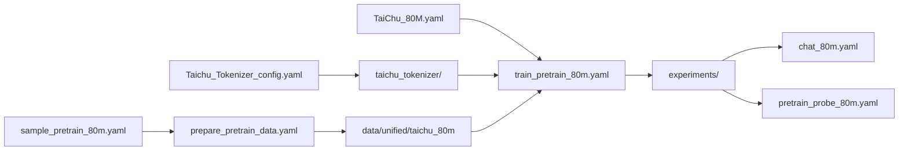

# 配置指南

TaiChu 的配置分为模型、预训练、数据准备、推理四类。所有加载器都拒绝未知字段，
避免拼写错误被默认值静默吞掉。

## 1. 配置关系



## 2. 模型配置

结构示例：

```yaml
model_name: "TaiChu-80M"

architecture:
  vocab_size: 32768
  hidden_size: 512
  num_layers: 16
  num_attention_heads: 8
  num_key_value_heads: 2
  intermediate_size: 2176
  max_position_embeddings: 2048
  rope_theta: 10000.0
  rms_norm_eps: 1.0e-6
  tie_word_embeddings: true

activation:
  hidden_act: "silu"
  ffn_type: "swiglu"

attention:
  use_flash_attention: true

regularization:
  attention_dropout: 0.0
  hidden_dropout: 0.0
  embedding_dropout: 0.0
```

关键约束：

- `hidden_size` 必须能被 `num_attention_heads` 整除。
- `num_attention_heads` 必须能被 `num_key_value_heads` 整除。
- 每个 Head 的维度必须为偶数。
- `vocab_size` 必须与 Tokenizer 一致或更大。
- `packing.max_seq_length` 不得超过 `max_position_embeddings`。

## 3. 预训练配置

### 3.1 顶层结构

```text
optimizer
scheduler
tokenizer
data
training
evaluating
early_stopping
swanlab
```

### 3.2 三档预设

| 字段 | 80M | 150M | 190M |
|---|---:|---:|---:|
| Learning Rate | `3e-4` | `3e-4` | `3e-4` |
| Warmup Ratio | 0.03 | 0.02 | 0.02 |
| Stable Ratio | 0.70 | 0.70 | 0.70 |
| Min LR Ratio | 0.19 | 0.10 | 0.10 |
| Target Tokens | 4.0B | 5.2B | 7.0B |
| Micro Batch | 8 | 4 | 2 |
| Accumulation | 32 | 64 | 128 |
| Token / Step（单进程） | 524,288 | 524,288 | 524,288 |
| Save Interval | 1,000 | 1,000 | 1,000 |
| Eval Interval | 500 | 500 | 500 |
| Compile Mode | `default` | `auto` | `auto` |

三档都使用 AdamW、`beta=(0.9, 0.95)`、`weight_decay=0.1`、BF16 AMP、
`max_grad_norm=1.0`、Seed `42`。

### 3.3 Batch 与梯度累积

训练 Batch 的唯一来源是：

```yaml
data:
  batching:
    micro_batch_size: 8

training:
  gradient_accumulation_steps: 32
```

单进程每步 Token：

```text
tokens_per_step =
    micro_batch_size
    × gradient_accumulation_steps
    × world_size
    × sequence_length
```

多卡时如果希望保持 `524,288 Token / Step`，应把
`gradient_accumulation_steps` 按 `world_size` 缩小。

### 3.4 数据字段

```yaml
data:
  schema_version: 1
  task_type: pretraining
  dataset_id: taichu-pretraining-v1
  storage:
    format: binary_mmap
    train_path: "./data/unified/taichu_80m/train"
    validation_path: "./data/unified/taichu_80m/validation"
    num_workers: 2
    prefetch_factor: 2
  sampling:
    strategy: distributed
    shuffle: true
    seed: 42
    drop_last: true
  pad_token: "<|pad|>"
  bos_token: "<|taichu_start|>"
  eos_token: "<|taichu_end|>"
  packing:
    enabled: true
    strategy: stream
    max_seq_length: 2048
    pad_to_multiple_of: 8
    drop_last_remainder: false
  batching:
    strategy: fixed_length
    micro_batch_size: 8
    pad_to_multiple_of: 8
```

## 4. 数据准备配置

### 4.1 Source Sampling

`configs/sample_pretrain_80m.yaml` 按 GB 权重选择原始 JSONL 记录：

- `target_total_gb`
- `validation_fraction`
- `min_chars` / `max_chars`
- 每个 Source 的 `patterns` 与 `weight_gb`

命令：

```powershell
python -m dataset.offline.sample_sources `
  --config configs/sample_pretrain_80m.yaml `
  --dry-run
```

`--dry-run` 只检查路径与预算，适合在正式抽样前验证数据位置。

### 4.2 Document Preparation

`configs/prepare_pretrain_data.yaml` 控制：

- `tokenizer_path`
- `output_dir`
- `dataset_id` / `version`
- `processing_workers` / `output_workers`
- `segmentation`
- `dedup`
- `splits`
- `cleaning`
- `sources`

命令：

```powershell
python -m dataset.offline.prepare `
  --config configs/prepare_pretrain_data.yaml
```

输出目录已存在时默认失败；中断后的 Staging 目录可通过 `--restart` 处理。

## 5. 当前路径与身份问题

本轮文档审计发现以下配置问题，但按照任务约束未修改实验配置：

1. `prepare_pretrain_data.yaml` 的 `output_dir` 是作者本机
   `E:/Academic/...` 路径。
2. `train_pretrain_80m.yaml` 的训练/验证路径同样是 `E:/Academic/...`。
3. `prepare_pretrain_data.yaml` 的 `dataset_id` 为 `taichu-pretraining`，
   而 `train_pretrain_80m.yaml` 为 `taichu-pretraining-v1`。
4. 150M/190M 训练配置使用仓库相对路径 `./data/unified/...`，与 80M
   配置不一致。

公开复现时应同时修改并保持：

```text
prepare.dataset_id
train.data.dataset_id

prepare.output_dir
train.data.storage.train_path
train.data.storage.validation_path
```

训练恢复会校验 Checkpoint 中的 `DataState` 与当前 Reader 的 Dataset ID/Version；
身份不一致时应拒绝恢复，而不是猜测数据进度。

## 6. 推理配置

### Chat

```yaml
checkpoint: "../experiments/80m/taichu_80m_pretrain_v1/best_models/best_model.pt"
tokenizer: "../taichu_tokenizer"
device: "auto"
dtype: "auto"
context_tokens: null

sampling:
  max_new_tokens: 256
  temperature: 0.8
  top_k: 50
  top_p: 0.9
  repetition_penalty: 1.05
  seed: 42
```

配置文件中的相对路径按配置文件所在目录解析。找不到实验权重时应通过
`--checkpoint` 覆盖。

### Pretrain Probe

Probe 使用相同的最小推理产物，但采样更保守：

```yaml
sampling:
  max_new_tokens: 128
  temperature: 0.6
  top_k: 10
  top_p: 0.9
  repetition_penalty: 1.0
  seed: 42
```

## 7. SwanLab

```yaml
swanlab:
  use_swanlab: true
  swanlab_project: "TaiChu"
  swanlab_workspace: "ByteWyrm"
  swanlab_experiment_name: "taichu_80m"
  swanlab_mode: "cloud"
  swanlab_id: null
  swanlab_resume: null
  swanlab_init_kwargs: {}
```

恢复训练时，训练器优先读取配置或 Checkpoint 中保存的 SwanLab ID。正式续训建议：

```yaml
swanlab_id: "<run-id>"
swanlab_resume: "must"
```

也可通过 CLI 覆盖：

```powershell
python -m trainer.train_pretrain `
  --model_config configs/TaiChu_80M.yaml `
  --pretrain_config configs/train_pretrain_80m.yaml `
  --resume <experiment-dir>/checkpoints/checkpoint-<step>.pt `
  --swanlab_workspace ByteWyrm `
  --swanlab_id <run-id> `
  --swanlab_resume must
```

## 8. 严格校验原则

- 未知键直接报错。
- Token Budget 支持 `4B`、`100M`、`1.2T`。
- `drop_last` 在未显式设置时根据训练/验证场景取默认值。
- Chat 与 Probe 会校验采样参数、上下文预算和 Checkpoint 类型。
- 完整训练 Checkpoint 不能直接作为 Chat 权重；Chat 应加载 `best_models/` 或
  `final_models/` 中的最小产物。
