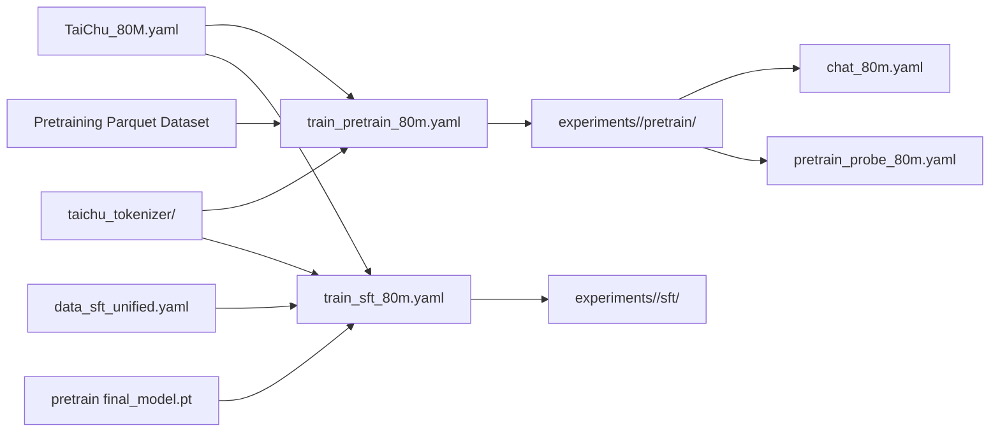

# 配置指南

TaiChu 的配置分为模型、预训练、SFT、数据准备、推理五类。所有加载器都拒绝未知字段，
避免拼写错误被默认值静默吞掉。

## 1. 配置关系



## 2. 模型配置

结构示例：

```yaml
model_name: "TaiChu-80M"

architecture:
  vocab_size: 32768
  hidden_size: 512
  num_layers: 16
  num_attention_heads: 8
  num_key_value_heads: 2
  intermediate_size: 2176
  max_position_embeddings: 2048
  rope_theta: 10000.0
  rms_norm_eps: 1.0e-6
  tie_word_embeddings: true

activation:
  hidden_act: "silu"
  ffn_type: "swiglu"

attention:
  use_flash_attention: true

regularization:
  attention_dropout: 0.0
  hidden_dropout: 0.0
  embedding_dropout: 0.0
```

关键约束：

- `hidden_size` 必须能被 `num_attention_heads` 整除。
- `num_attention_heads` 必须能被 `num_key_value_heads` 整除。
- 每个 Head 的维度必须为偶数。
- `vocab_size` 必须与 Tokenizer 一致或更大。
- `packing.max_seq_length` 不得超过 `max_position_embeddings`。

## 3. 预训练配置

### 3.1 顶层结构

```text
optimizer
scheduler
tokenizer
data
training
evaluating
early_stopping
swanlab
```

### 3.2 保留样例

基础预训练配置为 `train_pretrain_80m.yaml`：

- Learning Rate 为 `3e-4`，Warmup Ratio 为 `0.03`，Stable Ratio 为 `0.70`
- Min LR Ratio 为 `0.19`，Decay Type 为 `cosine`
- Target Tokens 为 `4.0B`
- Micro Batch 为 `8`，Accumulation 为 `32`
- 单进程 Token / Step 为 `524,288`
- Save Interval 为 `1,000`，Eval Interval 为 `500`
- 使用 AdamW、`beta=(0.9, 0.95)`、`weight_decay=0.1`、BF16 AMP、
  `max_grad_norm=1.0`、Seed `42`

`training.output_dir` 是实验父目录，Run 目录由
`output_dir / experiment_name` 唯一确定。模型规格和 stage 仅作为元数据，
不会再次拼入路径。例如：

```text
experiments/80m_8B/sft/taichu_sft_v1/
```

解析是幂等的：如果 `output_dir` 已经是完整实验目录，则不会再次追加
`experiment_name`。模型规格和 stage 的不同不会产生额外目录层级。

### 3.3 Batch 与梯度累积

训练 Batch 的唯一来源是：

```yaml
training:
  micro_batch_size: 8
  gradient_accumulation_steps: 32
```

预训练目标 Token 统计的是实际非 Padding 输入 Token，不使用
`micro_batch_size × sequence_length` 作为数据量。Trainer 在每次优化更新后累计
全局非 Padding Token，并在达到 `target_tokens` 后停止。

`sequence_length` 只是 Packing 的物理上限。Runtime Packing 会把多条短样本组合为
连续序列，因此实际 Step 数由数据 Token 数和 Packing 结果决定。

如果预训练配置不填写 `target_tokens`，则默认训练一个完整 DataLoader Epoch。此时
`epochs` 仍不适用于预训练，不应同时填写。

多卡时如果希望保持 `524,288 Token / Step`，应把
`gradient_accumulation_steps` 按 `world_size` 缩小。

### 3.4 数据字段

```yaml
data:
  schema_version: 1
  task_type: pretraining
  dataset_id: taichu-pretraining-4b
  storage:
    format: parquet
    train_path: "./data/unified/taichu_80m_4b/train"
    validation_path: "./data/unified/taichu_80m_4b/validation"
    num_workers: 2
    prefetch_factor: 2
  sampling:
    strategy: distributed
    shuffle: true
    seed: 42
    drop_last: true
  pad_token: "<|pad|>"
  bos_token: "<|taichu_start|>"
  eos_token: "<|taichu_end|>"
  packing:
    enabled: true
    strategy: stream
    max_seq_length: 2048
    pad_to_multiple_of: 8
    drop_last_remainder: false
  batching:
    strategy: fixed_length
    pad_to_multiple_of: 8
```

当前 `configs/train_pretrain_80m.yaml` 与 SFT 一样通过 `data_config` 引用独立的
Runtime 数据配置：

```yaml
data_config: "./data_pretraining_unified.yaml"
```

训练配置只允许 `data` 与 `data_config` 二选一。Runtime Loader 启动时会校验
配置中的 `dataset_id` 与 Parquet split Manifest 的身份一致。

训练 batch 参数位于 `training`：

```yaml
training:
  micro_batch_size: 8
```

### 3.5 SFT 配置

`configs/train_sft_80m.yaml` 通过 `data_config` 引用
`configs/data_sft_unified.yaml`，避免重复维护 SFT Runtime 数据字段。训练配置
只允许 `data` 与 `data_config` 二选一，且两者不能同时出现。

```yaml
data_config: "./data_sft_unified.yaml"

training:
  epochs: 2.0
  micro_batch_size: 4
  gradient_accumulation_steps: 16
```

SFT 不使用 `target_tokens` 估算步数，因为会话级 padding 会使
`max_seq_length × batch` 明显大于真实 input token。训练器按 DataLoader 的真实
Batch 数、梯度累积和 `epochs` 推导 `max_steps`。

SFT/推理协议只识别 `<|think|>` 与 `<|/think|>`。离线数据准备会将来源中的
`<think>`、`</think>` 转换为标准特殊 Token；Chat Template 不把旧文本标签当作
推理控制符。每轮消息只使用一个 `<|taichu_end|>`，Assistant EOS 直接纳入 Loss。

SFT 构建配置新增：

- `reasoning_sample_ratio`: 确定性保留含标准推理块样本的比例。其余样本删除
  推理块，只监督最终回答。
- `drop_system`: 删除所有 system message，保证推理时无需 system prompt。
- `min_assistant_tokens`: 整段 conversation 的 Assistant Token 总数下限，避免
  多轮对话中的短回复（如“好的”）导致整条样本被删除。
- `max_assistant_tokens`: 单条 Assistant 回复的 Token 上限。
- 验证集按 category 分层，构建 Manifest 记录推理比例、Assistant Token 分位数
  以及来源/类别监督 Token 占比；同时记录多轮样本数量与占比。

默认 SFT 构建 profile 为 `80m_multiturn`，输出
`SFT/unified/80m_multiturn_v1`。它保留原 129,000 条配比并新增 40,000 条
中英多轮样本。来源、许可证和下载方式见
[多轮 SFT 数据来源](MULTITURN_SFT_DATA.md)。
构建完成后，需要把 `configs/data_sft_unified.yaml` 的 `dataset_id` 与
`storage` 路径切到 `80m_multiturn_v1`，再启动训练。

关键约束：

- `task_type` 必须为 `sft` 或 `instruction_tuning`。
- `packing.strategy` 必须为 `sample_isolated`。
- 当前 Trainer 只接受 `fixed_length`，拒绝尚未接入模型的 `padding_free` 扁平契约。
- `--init_from` 只加载预训练最小模型产物；`--resume` 恢复完整 SFT Checkpoint，
  两者互斥。

| 当前样例 | SFT 配置 | Effective Batch | 初始 LR |
|---|---|---:|---:|
| 80M | `train_sft_80m.yaml` | 96 | `2e-5` |

## 4. 数据准备配置

### 4.1 Source Sampling

`configs/sample_pretrain_80m.yaml` 按 GB 权重选择原始 JSONL 记录：

- `target_total_gb`
- `validation_fraction`
- `min_chars` / `max_chars`
- 每个 Source 的 `patterns` 与 `weight_gb`

命令：

```powershell
python -m dataset.offline.sample_sources `
  --config configs/sample_pretrain_80m.yaml `
  --dry-run
```

`--dry-run` 只检查路径与预算，适合在正式抽样前验证数据位置。

### 4.2 Document Preparation

`configs/prepare_pretrain_data.yaml` 控制：

- `tokenizer_path`
- `output_dir`
- `dataset_id` / `version`
- `format`（预训练默认 `parquet`）
- `processing_workers` / `output_workers`
- `segmentation`
- `dedup`
- `splits`
- `cleaning`
- `sources`
- `selection.target_tokens` / `selection.mixture` / `selection.mixture_manifest_path`

命令：

```powershell
python -m dataset.offline.prepare `
  --config configs/prepare_pretrain_data.yaml
```

输出目录已存在时默认失败；中断后的 Staging 目录可通过 `--restart` 处理。
可临时覆盖目标 Token 和来源比例：

```powershell
python -m dataset.offline.prepare `
  --config configs/prepare_pretrain_data.yaml `
  --target-tokens 100M `
  --mixture fineweb2_zh=0.6 `
  --mixture fineweb_edu_en=0.4
```

## 5. 路径与身份约束

当前预训练样例统一使用 80M/4B 数据预算：
`prepare_pretrain_data.yaml` 生成 `taichu-pretraining-4b`，
`train_pretrain_80m.yaml` 读取同一数据集身份。正式训练前仍应确认输出目录与实际
数据位置一致。

公开复现时应保持：

```text
prepare.dataset_id
train.data.dataset_id

prepare.output_dir
train.data.storage.train_path
train.data.storage.validation_path
```

训练恢复会校验 Checkpoint 中的 `DataState` 与当前 Reader 的 Dataset ID/Version；
身份不一致时应拒绝恢复，而不是猜测数据进度。

## 6. 推理配置

### Chat

```yaml
checkpoint: "../experiments/80m/pretrain/4b_v2/best_models/best_model.pt"
tokenizer: "../taichu_tokenizer"
device: "auto"
dtype: "auto"
context_tokens: null

sampling:
  max_new_tokens: 256
  temperature: 0.8
  top_k: 50
  top_p: 0.9
  repetition_penalty: 1.05
  seed: 42
```

配置文件中的相对路径按配置文件所在目录解析。找不到实验权重时应通过
`--checkpoint` 覆盖。

### Pretrain Probe

Probe 使用相同的最小推理产物，但采样更保守：

```yaml
sampling:
  max_new_tokens: 128
  temperature: 0.6
  top_k: 10
  top_p: 0.9
  repetition_penalty: 1.0
  seed: 42
```

## 7. SwanLab

```yaml
swanlab:
  use_swanlab: true
  swanlab_project: "TaiChu"
  swanlab_workspace: "ByteWyrm"
  swanlab_experiment_name: "taichu_80m"
  swanlab_mode: "cloud"
  swanlab_id: null
  swanlab_resume: null
  swanlab_init_kwargs: {}
```

恢复训练时，训练器优先读取配置或 Checkpoint 中保存的 SwanLab ID。正式续训建议：

```yaml
swanlab_id: "<run-id>"
swanlab_resume: "must"
```

也可通过 CLI 覆盖：

```powershell
python -m trainer.train_pretrain `
  --model_config configs/TaiChu_80M.yaml `
  --pretrain_config configs/train_pretrain_80m.yaml `
  --resume <experiment-dir>/checkpoints/checkpoint-<step>.pt `
  --swanlab_workspace ByteWyrm `
  --swanlab_id <run-id> `
  --swanlab_resume must
```

## 8. 严格校验原则

- 未知键直接报错。
- Token Budget 支持 `4B`、`100M`、`1.2T`。
- `drop_last` 在未显式设置时根据训练/验证场景取默认值。
- Chat 与 Probe 会校验采样参数、上下文预算和 Checkpoint 类型。
- 完整训练 Checkpoint 不能直接作为 Chat 权重；Chat 应加载 `best_models/` 或
  `final_models/` 中的最小产物。
