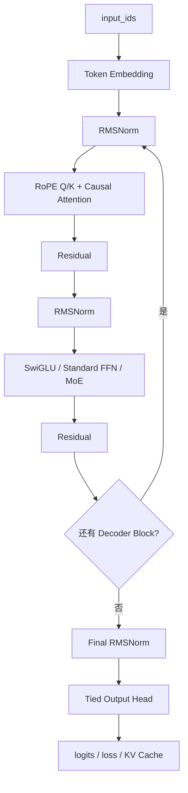

# 模型与 Tokenizer

本文说明 TaiChu 当前的模型结构、参数量、Token 协议与可验证边界。模型配置以
`configs/TaiChu_*.yaml` 为事实源，行为以 `model/` 和架构测试为准。

## 1. 模型定位

当前三档预设均为 Dense、Decoder-only、自回归 Causal LM：

| 配置 | 参数量 | Hidden | Layers | Q Heads | KV Heads | FFN | Context | RoPE Theta |
|---|---:|---:|---:|---:|---:|---:|---:|---:|
| `TaiChu_80M.yaml` | 80,757,248 | 512 | 16 | 8 | 2 | 2,176 | 2,048 | 10,000 |
| `TaiChu_150M.yaml` | 149,057,280 | 768 | 18 | 12 | 4 | 2,304 | 2,048 | 10,000 |
| `TaiChu_190M.yaml` | 191,394,816 | 1,024 | 14 | 16 | 4 | 2,816 | 2,048 | 10,000 |

共同配置：

- 词表大小 `32,768`
- Pre-Norm + RMSNorm
- SwiGLU 前馈网络
- RoPE 位置编码
- GQA
- 输入 Embedding 与输出 Head 权重绑定
- Dropout 均为 `0.0`
- 三档公开预设均为 Dense；MoE 是保留架构能力，不在当前三档中启用

## 2. 前向结构



实现位置：

| 文件 | 职责 |
|---|---|
| `model/model.py` | 模型组装、统一输出、Loss、KV Cache、`generate` |
| `model/attention.py` | Padding Mask、Segment Mask、GQA、SDPA、KV 拼接 |
| `model/transformer_block.py` | Pre-Norm 残差块 |
| `model/feedforward.py` | SwiGLU、Standard FFN、MoE Adapter |
| `model/positional_encoding.py` | RoPE 缓存与旋转应用 |
| `model/output_head.py` | 输出投影与权重绑定 |
| `training/model_info.py` | 参数统计、显存估算、梯度统计 |

## 3. 参数量公式

在权重绑定且 Bias 全部关闭的情况下：

```text
embedding = V × H
attention = H² + 2 × H × K × d + H²
ffn       = 3 × H × I
norms     = 2 × H
head      = 0（与 embedding 绑定）

params = VH + N × (attention + ffn + norms) + H
```

其中：

- `V = vocab_size`
- `H = hidden_size`
- `N = num_layers`
- `Q = num_attention_heads`
- `K = num_key_value_heads`
- `d = H / Q`
- `I = intermediate_size`

`tests/test_architecture_audit.py` 会在 `meta` 设备上构造三档模型并逐项校验参数量
与 Token Budget。参数表不是手工估算值。

## 4. Attention 与 Packing

### 普通 Causal Attention

无 Padding、无 Packing 时使用 SDPA 的 `is_causal=True` 快路径。有 Padding Mask 时，
构造布尔可见性：

```text
allowed(i, j) = j <= i AND attention_mask[j]
```

### Packed Sequence

Packing 会保留 `segment_ids`。Batch Builder 将文档边界映射为 Group ID，并按 Group
重置 `position_ids`。模型构造：

```text
allowed(i, j) =
    j <= i
    AND segment_id[i] == segment_id[j]
    AND segment_id[j] >= 0
    AND attention_mask[j] != 0
```

因此不同文档、同一文档的不同滑动窗口即使物理拼接，也不能互相 Attention。

### KV Cache

KV Cache 布局为：

```text
(batch, num_key_value_heads, total_sequence_length, head_dim)
```

增量解码当前不接受 `segment_ids` 或自定义 `position_ids`，使用普通连续位置与
因果语义。Packed 训练 Attention 与增量 Chat 路径需要分别测试。

## 5. MoE 边界

代码保留：

- Sparse MoE 路由。
- Top-K 专家选择。
- 0 或 1 个共享专家。
- Load-balancing auxiliary loss。
- Router z-loss。
- CE 与 Auxiliary Loss 独立分量。

但当前公开三档模型均为 Dense，MoE 性能、扩展性和大规模训练结果尚未审计。

## 6. Tokenizer

### 训练协议

配置：[`configs/TaiChu_Tokenizer_config.yaml`](../configs/TaiChu_Tokenizer_config.yaml)

| 组件 | 实现 |
|---|---|
| Normalizer | NFC |
| Pre-tokenizer | Byte-level、Regex、数字拆分 |
| Model | BPE |
| Vocab | 32,768 |
| Min Frequency | 2 |
| Prefix Space | 关闭 |

Tokenizer 训练配置中的语料路径是作者本机路径。公开复现时必须修改
`data.files`，或使用训练入口覆盖参数。

### 特殊 Token

| ID | Token | 约定 |
|---:|---|---|
| 0 | `<\|pad\|>` | Padding，标签应为 `-100` |
| 1 | `<unk>` | Unknown |
| 2 | `<\|endoftext\|>` | 通用文本结束 |
| 3 | `<\|taichu_start\|>` | BOS / 消息开始 |
| 4 | `<\|taichu_end\|>` | EOS / 消息结束 |
| 5 | `<\|think\|>` | 思考区段开始 |
| 6 | `<\|/think\|>` | 思考区段结束 |
| 7 | `<\|ghissue\|>` | 保留 |
| 8 | `<\|final\|>` | 保留 |

特殊 Token 必须由 `tokenizer/special_tokens.py` 代码定义，不能通过 YAML 注入；
`tokenizer_config.json` 与 `special_tokens_map.json` 会校验 ID。

### Chat Template

模板由 `tokenizer/template.py` 定义，支持：

- system / user / assistant 多轮消息
- 空消息过滤
- `reasoning_content`
- `<|think|>` / `<|/think|>`
- `add_generation_prompt`

模板渲染示例：

```text
<|taichu_start|>system
你是 TaiChu。
<|taichu_end|>
<|taichu_start|>user
你好
<|taichu_end|>
<|taichu_start|>assistant
```

### 验证命令

```powershell
python -m trainer.validate_tokenizer `
  --config configs/TaiChu_Tokenizer_config.yaml `
  --tokenizer_dir taichu_tokenizer `
  --vocab_size 32768
```

验证包括词表大小、特殊 Token ID、文件协议、随机 Unicode 往返、单条/批量一致性和
Hugging Face 兼容加载。

## 7. 当前边界

- 仓库不分发训练好的完整模型权重。
- 公开 80M 权重是预训练基座，不是 SFT 助手。
- 三档模型只验证结构与配置，不代表 150M/190M 已完成公开训练。
- FlashAttention 优先路径依赖硬件和 PyTorch 后端，CPU 会回退。
- 增量 Chat 不支持 Segment Mask 和自定义 Position IDs。
- Tokenizer 元数据许可证字段仍需与仓库许可证统一。
